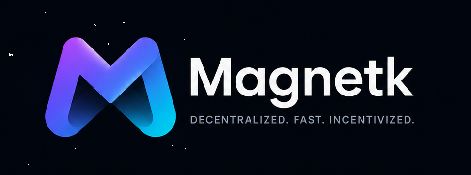

# Magnetk



**Decentralized communication middleware. Fast, payment-native, AI-native.**

Magnetk (Magnetic Network) is a peer-to-peer communication layer built on QUIC transport, distributed peer discovery, and blockchain-native payments. It moves files, messages, streams, model weights, and compute instructions between machines — with no central server, no CDN, and no broker in the middle.

The more peers join, the faster the network becomes. Demand generates supply automatically.

---

## The Problem

Every major data movement system today — HTTP servers, Kafka brokers, S3 buckets, CDN edge nodes — requires someone to own and operate a central point that all traffic flows through.

- More demand = higher cost, slower speed, single point of failure
- A game launch, a model release, a viral video — all cause cost spikes and slowdowns
- Traditional servers get slower and more expensive as popularity grows

Magnetk inverts this. More users means more seeders, which means faster speeds and lower costs for everyone.

---

## What Magnetk Does Or Will Solve

### File and Data Transfer
Large files — games, datasets, model weights — are downloaded in parallel from multiple peers simultaneously over QUIC. Every downloader automatically becomes a seeder. Speed increases as more people join, not decreases.

### Real-Time Communication
Peers send messages, events, and RPC calls directly to each other without a broker. Sub-50ms messaging over QUIC, decentralized pub/sub event bus, and distributed RPC — all without a central server.

### Live Streaming
Continuous data streams (video, audio, sensor data, AI token output) flow peer-to-peer over QUIC. Every receiver re-seeds chunks to other receivers automatically. The audience becomes the CDN.

### AI Infrastructure
Model weights distributed P2P faster than any CDN. Differential sync for model updates — only changed layers are re-distributed. LLM token streaming over QUIC with lower latency than HTTP/2. Shared KV cache for common prefixes. Training data pipelines across distributed peers.

### AI Compute Distribution
Inference requests routed to the right model size by complexity. Large models sharded across multiple peers so consumer hardware can participate. Speculative decoding split across draft and verifier peers. Federated inference for privacy-sensitive data.

### AI Agent Mesh
Agents discover each other through DHT by capability. They communicate directly, share context peer-to-peer, and pay each other for completed tasks — all without a central orchestrator.

### Built-In Payments
Smart contracts handle everything automatically. Seeders earn per chunk delivered. Relay operators earn per assisted connection. GPU nodes earn per inference unit. The developer earns a protocol fee on every transaction. No invoices, no manual work, no payment processor beyond the initial fiat on-ramp.

Users pay with VISA or crypto. Crypto conversion happens invisibly in the background.

**Consider all those as upcoming not fully yet implemented**

---

## How It Works

```
Downloader requests a file
        ↓
DHT finds peers currently seeding it (free)
        ↓ (if insufficient peers)
Relay-assisted peers bridge NAT connections (small fee)
        ↓ (if still insufficient)
Staked blockchain nodes fill the gap (market rate)
        ↓ (for large transfers)
All sources deliver chunks in parallel simultaneously

Download completes
        ↓
Smart contract splits payment proportionally
Seeder A delivered 60% of chunks → earns 60% of seeder fee
Seeder B delivered 40% of chunks → earns 40% of seeder fee
Protocol fee → developer wallet
Everything automatic, on-chain, no manual steps
```

The network always has content available. A file with zero organic seeders is served by staked blockchain nodes — existing validator infrastructure that earns extra revenue by participating in the Magnetk seeder pool.

---

## Compared to Alternatives

| System | Strength | Missing |
|---|---|---|
| IPFS / Filecoin | Content-addressed storage | Real-time messaging, payments, AI-native design |
| BitTorrent | File distribution | Payments, streaming, messaging |
| Apache Kafka | High-throughput event streaming | No central broker option, large binary payloads |
| gRPC | Fast RPC | Requires central service registry |
| WebRTC | Browser P2P | No payment layer, no large file support |
| HTTP / CDN | Universal compatibility | Cost scales with demand, single origin |

Magnetk is the only system that combines all four: **QUIC transport + DHT routing + blockchain payments + AI-native design.**

---

## SDKs

| Language | Transport | Status |
|---|---|---|
| Go | QUIC (MsQuic) | Available |
| JavaScript (Node.js) | TCP fallback | Available |
| Python | QUIC | Available |
| C++ | QUIC | Available |
| React Native / Flutter | — | Roadmap |
| Browser (WebRTC) | WebRTC | Roadmap |

### Go
```go
import "github.com/iMarand/magnetk/sdk/go/magnetk"

cfg := magnetk.DefaultConfig()
client, err := magnetk.NewClient(cfg)

err = client.Download("magnetk:?xt=urn:sha256:...", "./output.file")
```

### JavaScript
```javascript
import { MagnetkClient } from './client.js';

const client = new MagnetkClient();
await client.download('magnetk:?xt=urn:sha256:...', './downloads');
```

### C++
```cpp
#include "magnetk.hpp"

magnetk::Client client;
client.download("magnetk:?xt=...", "./out.dat");
```

---

## Installation

### Prerequisites
- Go v1.20+
- GCC — Windows: MinGW-w64 · Linux: build-essential · macOS: Xcode Command Line Tools
- CMake v3.16+ (C++ SDK)
- Node.js v16+ (JS SDK)

### Clone and Build

```bash
git clone https://github.com/iMarand/magnetk.git
cd magnetk
```

**Linux / macOS**
```bash
chmod +x scripts/build.sh
./scripts/build.sh
```

**Windows (PowerShell)**
```powershell
$env:Path = "C:\msys64\mingw64\bin;" + $env:Path
./scripts/build.bat
```

---

## Architecture

```
┌─────────────────────────────────────────────────────┐
│                   Your Application                   │
└──────────────────────┬──────────────────────────────┘
                       │
┌──────────────────────▼──────────────────────────────┐
│              Magnetk SDK                             │
│  Files · Messages · Streams · RPC · Agent Mesh      │
└──────────────────────┬──────────────────────────────┘
                       │
       ┌───────────────┼───────────────┐
       ▼               ▼               ▼
┌──────────┐   ┌──────────────┐   ┌──────────────┐
│ QUIC/UDP │   │  DHT LibP2P  │   │  Blockchain  │
│ TCP fall │   │  Peer disco  │   │  Payments    │
│ -back    │   │  + routing   │   │  + trust     │
└──────────┘   └──────────────┘   └──────────────┘
       │               │               │
       └───────────────┼───────────────┘
                       ▼
┌─────────────────────────────────────────────────────┐
│               Peer Network                           │
│  Seeders · Relay nodes · Staked blockchain nodes    │
│  GPU compute peers · AI agents                      │
└─────────────────────────────────────────────────────┘
```

**Ports**

| Job | Protocol | Port |
|---|---|---|
| Peer discovery (Go/Python) | TCP LibP2P | 4001 |
| Peer discovery (JS) | TCP Raw | 4003 |
| Data transfer (Go/Python/C++) | QUIC UDP | 4002 |
| Data transfer (JS) | TCP Raw | 4002 |

---

## Who Uses Magnetk

**Game studios** — publish once, the community seeds. Launch-day speeds increase as player count grows instead of collapsing under load. No CDN bill.

**AI companies** — distribute model weights at P2P speed. Delta updates only re-distribute changed layers. Shared KV cache eliminates redundant prefix computation across users.

**Healthcare and finance** — federated inference where sensitive data never leaves the local environment. Compliance is a feature of the architecture, not an add-on.

**Edge deployments** — vehicles, robots, retail AI — where low-latency peer communication cannot route through a distant central server.

**Multi-agent AI systems** — agents discover each other by capability, communicate directly, and pay each other for completed tasks without a central orchestrator.

**Open-source AI communities** — distribute model weights and datasets through a self-sustaining network where contributors earn for seeding.

---

## Roadmap

| Phase | Focus |
|---|---|
| ✅ Current | QUIC transport, single-file transfer, relay, basic SDKs |
| 🔨 Phase 1 | Multi-seeder download, DHT, NAT hole punching, reliable foundation |
| 🔨 Phase 2 | Smart contract payments, chunk accounting, VISA on-ramp |
| 🔨 Phase 3 | Tiered resource system, staked node registry, guaranteed availability |
| 📋 Phase 4 | Messaging, pub/sub event bus, distributed RPC, live streaming |
| 📋 Phase 5 | AI model distribution, delta sync, KV cache sharing, RAG pipeline |
| 📋 Phase 6 | AI compute routing, model sharding, federated inference |
| 📋 Phase 7 | AI agent mesh, capability discovery, agent-to-agent payments |
| 📋 Phase 8 | Mobile SDKs, browser SDK, IoT client, enterprise QoS |
| 📋 Phase 9 | On-chain governance, reputation system, cross-chain payments |

Full architecture: [MagnetkCore.md](./docs/MAGNETK_CORE.md)
Full development roadmap: [Roadmap.md](./docs/ROADMAP.md)

---

## Troubleshooting

**Build fails on Windows** — use MinGW-w64 GCC. If `go build` returns `exit status 2` you are using MSYS2 POSIX GCC instead.

**Relay connection refused** — check that `bin/relay` is running and port 4001 is open.

**Slow download speeds** — check that you have enough peers seeding the file. Use `client.Peers(hash)` to see available seeders.

---

## Contributing

Contributions welcome. Open an issue before starting large changes so we can discuss approach first. any suggestion I am open to talk about and feedback

## Contacts

If you want to get in contact with me please text me on
 - Email: imarand@proton.me
 - Linkedin: https://www.linkedin.com/in/imarand

