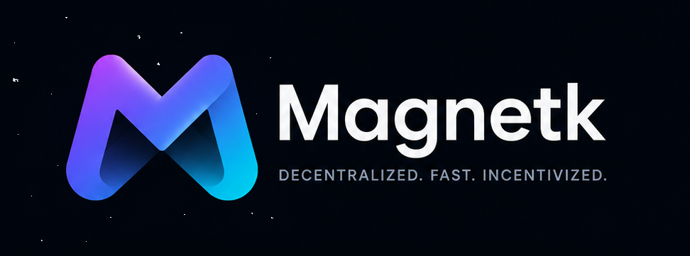
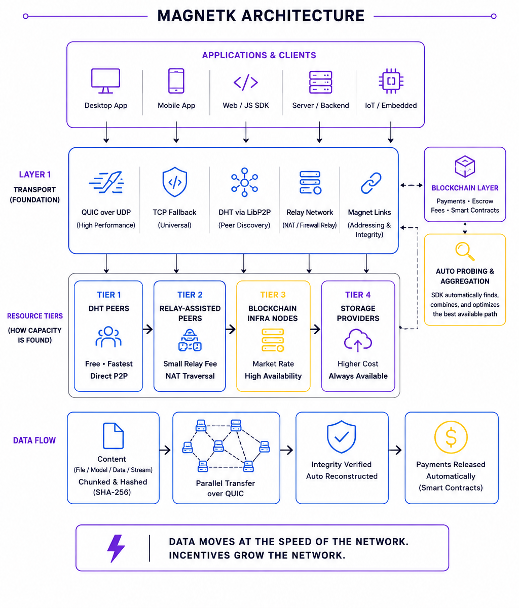

# Magnetk



**Decentralized communication middleware. Fast, payment-native, AI-native.**

Magnetk (Magnetic Network) is a peer-to-peer communication layer built on QUIC transport, distributed peer discovery, and blockchain-native payments. It moves files, messages, streams, model weights, and compute instructions between machines — with no central server, no CDN, and no broker in the middle.

The more peers join, the faster the network becomes. Demand generates supply automatically.

---

## The Problem

Every major data movement system today — HTTP servers, Kafka brokers, S3 buckets, CDN edge nodes — requires someone to own and operate a central point that all traffic flows through.

- More demand = higher cost, slower speed, single point of failure
- A game launch, a model release, a viral video — all cause cost spikes and slowdowns
- Traditional servers get slower and more expensive as popularity grows

Magnetk inverts this. More users means more seeders, which means faster speeds and lower costs for everyone.

---

## What Magnetk Does Or Will Solve

### File and Data Transfer
Large files — games, datasets, model weights — are downloaded in parallel from multiple peers simultaneously over QUIC. Every downloader automatically becomes a seeder. Speed increases as more people join, not decreases.

### Real-Time Communication
Peers send messages, events, and RPC calls directly to each other without a broker. Sub-50ms messaging over QUIC, decentralized pub/sub event bus, and distributed RPC — all without a central server.

### Live Streaming
Continuous data streams (video, audio, sensor data, AI token output) flow peer-to-peer over QUIC. Every receiver re-seeds chunks to other receivers automatically. The audience becomes the CDN.

### AI Infrastructure
Model weights distributed P2P faster than any CDN. Differential sync for model updates — only changed layers are re-distributed. LLM token streaming over QUIC with lower latency than HTTP/2. Shared KV cache for common prefixes. Training data pipelines across distributed peers.

### AI Compute Distribution
Inference requests routed to the right model size by complexity. Large models sharded across multiple peers so consumer hardware can participate. Speculative decoding split across draft and verifier peers. Federated inference for privacy-sensitive data.

### AI Agent Mesh
Agents discover each other through DHT by capability. They communicate directly, share context peer-to-peer, and pay each other for completed tasks — all without a central orchestrator.

### Built-In Payments
Smart contracts handle everything automatically. Seeders earn per chunk delivered. Relay operators earn per assisted connection. GPU nodes earn per inference unit. The developer earns a protocol fee on every transaction. No invoices, no manual work, no payment processor beyond the initial fiat on-ramp.

Users pay with VISA or crypto. Crypto conversion happens invisibly in the background.

**Consider all those as upcoming not fully yet implemented** — see *What works today* below for what is implemented.

---

## What works today (v2)

* **Relay-based network**: nodes connect out to one or more relays (any VPS), so everything works behind NAT, firewalls and mobile networks. Two or more relays **federate**: nodes on different relays reach each other, and nodes fail over automatically.
* **Peer-to-peer when possible**: pipes and file transfers go directly between nodes that can reach each other, and through the relay otherwise (`ROUTE=auto|direct|relay`).
* **Bidirectional messaging**: direct messages (with delivery receipts, offline storage or as unreliable datagrams), publish/subscribe with wildcards, queue groups (load balancing), request/reply to a node or to a service topic, presence and lookups.
* **Pipes**: reliable full-duplex byte streams between any two nodes.
* **Files**: content-addressed sharing, parallel multi-source downloads, every chunk verified, resumable, self-contained links. The in-flight window adapts to the network, compressible files are compressed on the fly, and byte-range downloads fetch only part of a file.
* **Transports**: QUIC (MsQuic, TLS 1.3, datagrams) with an automatic TCP + TLS 1.3 fallback on the same port.
* **SDKs**: Go, Python, C++, C (and the v1 JavaScript SDK through the relay's legacy port), an Android field-test app, and the `magnetk` CLI.
* **Secure identities and chat**: every device has an identity key. Relays bind node ids to keys, so nobody can use yours. Chat and voice notes are **end-to-end encrypted** and signed. Strangers arrive as message requests, and contacts can be verified with a safety number. `magnetk://node@relay?key=...` addresses carry proof of who answers ([security model](docs/SECURITY.md)).
* **Configurable**: one documented `settings.conf` (+ `MAGNETK_*` environment variables) for transport, routing, buffers, limits, CPU cores and memory.

```bash
magnetk relay                                   # on a VPS (or locally)
magnetk sub -relay vps:4002 "chat.>"            # terminal 1
magnetk pub -relay vps:4002 chat.general hello  # terminal 2
magnetk share -relay vps:4002 big.iso           # prints a magnetk link
magnetk get "magnetk:?xt=urn:sha256:..."        # anywhere (-offset 100MB -length 8MB for a byte range)
magnetk bench -local all                        # measure on this machine
magnetk chat -relay vps:4002 a52-3cc9 "hi"       # chat (text, -audio voice notes) with any node
magnetk open "magnetk://a52-3cc9@vps:4002/chat" # what clicking a magnetk:// link runs
magnetk id -relay vps:4002                      # your identity fingerprint + shareable magnetk:// address
```

Install (binary on PATH + `magnetk://` links): `scripts/install.sh` · Windows `scripts\install.ps1` · server `sudo scripts/install.sh --relay`.

Docs: [Architecture & protocol](docs/ARCHITECTURE.md) · [Running relays (1 or 2 VPS)](docs/RELAY_DEPLOYMENT.md) · [Field testing on phones](docs/FIELD_TEST.md) · [magnetk:// links and chat](docs/LINKS.md) · [Security](docs/SECURITY.md) · [Benchmarks](docs/BENCHMARKS.md) · [Configuration](config/settings.conf)

---

## How It Works

```
Downloader requests a file
        ↓
DHT finds peers currently seeding it (free)
        ↓ (if insufficient peers)
Relay-assisted peers bridge NAT connections (small fee)
        ↓ (if still insufficient)
Staked blockchain nodes fill the gap (market rate)
        ↓ (for large transfers)
All sources deliver chunks in parallel simultaneously

Download completes
        ↓
Smart contract splits payment proportionally
Seeder A delivered 60% of chunks → earns 60% of seeder fee
Seeder B delivered 40% of chunks → earns 40% of seeder fee
Protocol fee → developer wallet
Everything automatic, on-chain, no manual steps
```

The network always has content available. A file with zero organic seeders is served by staked blockchain nodes — existing validator infrastructure that earns extra revenue by participating in the Magnetk seeder pool.

---

## Compared to Alternatives

| System | Strength | Missing |
|---|---|---|
| IPFS / Filecoin | Content-addressed storage | Real-time messaging, payments, AI-native design |
| BitTorrent | File distribution | Payments, streaming, messaging |
| Apache Kafka | High-throughput event streaming | No central broker option, large binary payloads |
| gRPC | Fast RPC | Requires central service registry |
| WebRTC | Browser P2P | No payment layer, no large file support |
| HTTP / CDN | Universal compatibility | Cost scales with demand, single origin |

Magnetk is the only system that combines all four: **QUIC transport + DHT routing + blockchain payments + AI-native design.**

---

## SDKs

| Language | Transport | Status | Docs |
|---|---|---|---|
| Go | QUIC + TCP fallback | Available (v2) | [sdk/go](sdk/go/Documentation.md) |
| Python | QUIC + TCP fallback (native engine via ctypes) | Available (v2) | [sdk/python](sdk/python/Documentation.md) |
| C++ | QUIC + TCP fallback (header-only, loads libmagnetk) | Available (v2) | [sdk/cpp](sdk/cpp/Documentation.md) |
| C | QUIC + TCP fallback (`libmagnetk` C ABI) | Available (v2) | [sdk/c](sdk/c/README.md) |
| JavaScript (Node.js) | v1 protocol over TCP (relay legacy port 4003) | Available (v1) | [sdk/js](sdk/js) |
| Android | TCP + TLS 1.3 (engine as JNI library) | Field-test app | [android](docs/FIELD_TEST.md) |
| React Native / Flutter / iOS | — | Roadmap | |
| Browser (WebRTC / WebTransport) | — | Roadmap | |


## Installation
### Prerequisites
- Go 1.22+
- GCC for cgo — Windows: MSYS2 (`C:\msys64\ucrt64` or `mingw64`) · Linux: build-essential · macOS: Xcode Command Line Tools
- MsQuic is built from a `msquic/` checkout (the build scripts clone microsoft/msquic at a pinned commit if it is missing) (CMake, PowerShell 7; Visual Studio Build Tools on Windows, perl/make on Linux). Without it, `scripts/build.sh tcp` builds a pure-Go TCP + TLS binary.
- CMake 3.16+ (C++ SDK), Python 3.8+ (Python SDK), Node.js 16+ (JS SDK)
- Android SDK + NDK + JDK for the field-test APK (no Android Studio needed)

### Clone and Build

```bash
git clone https://github.com/iMarand/magnetk.git
cd magnetk
```

**Linux / macOS**
```bash
chmod +x scripts/build.sh
./scripts/build.sh
```

**Windows**
```bat
scripts\build.bat            :: add "msquic" to rebuild MsQuic, "android" for the APK, "all" for everything
```

Output: `build/bin/magnetk` (CLI) and `build/lib/libmagnetk` (C ABI for Python/C++/C, also copied into the Python package). Test everything:

```bash
cd go && go test ./...                 # engine, relay, transport, field-test kit
cd sdk/go && go test ./...             # Go SDK
python -m pytest sdk/python/tests      # Python SDK
cmake -S sdk/cpp -B sdk/cpp/build && cmake --build sdk/cpp/build && sdk/cpp/build/bin/test_sdk
```

---



## Architecture

```
┌─────────────────────────────────────────────────────┐
│                   Your Application                   │
└──────────────────────┬──────────────────────────────┘
                       │
┌──────────────────────▼──────────────────────────────┐
│              Magnetk SDK                             │
│  Files · Messages · Streams · RPC · Agent Mesh      │
└──────────────────────┬──────────────────────────────┘
                       │
       ┌───────────────┼───────────────┐
       ▼               ▼               ▼
┌──────────┐   ┌──────────────┐   ┌──────────────┐
│ QUIC/UDP │   │  DHT LibP2P  │   │  Blockchain  │
│ TCP fall │   │  Peer disco  │   │  Payments    │
│ -back    │   │  + routing   │   │  + trust     │
└──────────┘   └──────────────┘   └──────────────┘
       │               │               │
       └───────────────┼───────────────┘
                       ▼
┌─────────────────────────────────────────────────────┐
│               Peer Network                           │
│  Seeders · Relay nodes · Staked blockchain nodes    │
│  GPU compute peers · AI agents                      │
└─────────────────────────────────────────────────────┘
```

**Ports**

| Job | Protocol | Port |
|---|---|---|
| Relay: nodes and federation links (QUIC) | UDP | 4002 |
| Relay: TCP + TLS 1.3 fallback | TCP | 4002 |
| Relay: v1 / JavaScript SDK | TCP | 4003 |
| Node direct (peer-to-peer) listener | UDP + TCP | `DIRECT_PORT` (random by default) |
| Field-test host direct port | UDP + TCP | 4012 (the guide uses 4005) |
| Field-test host HTTPS (Magnetk-vs-HTTPS comparison) | TCP | 4443 |
| Field-test host dashboard (local only) | TCP | 127.0.0.1:8090 |

---

## Who Uses Magnetk

**Game studios** — publish once, the community seeds. Launch-day speeds increase as player count grows instead of collapsing under load. No CDN bill.

**AI companies** — distribute model weights at P2P speed. Delta updates only re-distribute changed layers. Shared KV cache eliminates redundant prefix computation across users.

**Healthcare and finance** — federated inference where sensitive data never leaves the local environment. Compliance is a feature of the architecture, not an add-on.

**Edge deployments** — vehicles, robots, retail AI — where low-latency peer communication cannot route through a distant central server.

**Multi-agent AI systems** — agents discover each other by capability, communicate directly, and pay each other for completed tasks without a central orchestrator.

**Open-source AI communities** — distribute model weights and datasets through a self-sustaining network where contributors earn for seeding.

---

## Roadmap

| Phase | Focus |
|---|---|
| ✅ Done (v2) | QUIC + TCP transport, relay federation and failover, messaging, pub/sub, RPC, pipes, multi-source verified downloads, Go/Python/C++/C SDKs, Android field-test app |
| ✅ Done (v2.1) | Adaptive pipeline, on-the-fly compression, byte-range downloads, encrypted file attachments in chat, AAC voice notes. Identity keys bound by relays, end-to-end encrypted and signed chat and voice notes, message requests, safety numbers, `magnetk://` addresses and link handlers, install scripts, Magnetk-vs-HTTPS comparison |
| 🔨 Phase 1 | Double Ratchet (forward secrecy), encrypted group chat, DHT, NAT hole punching, QUIC on Android, mobile SDKs |
| 🔨 Phase 2 | Smart contract payments, chunk accounting, VISA on-ramp |
| 🔨 Phase 3 | Tiered resource system, staked node registry, guaranteed availability |
| 📋 Phase 4 | Messaging, pub/sub event bus, distributed RPC, live streaming |
| 📋 Phase 5 | AI model distribution, delta sync, KV cache sharing, RAG pipeline |
| 📋 Phase 6 | AI compute routing, model sharding, federated inference |
| 📋 Phase 7 | AI agent mesh, capability discovery, agent-to-agent payments |
| 📋 Phase 8 | Mobile SDKs, browser SDK, IoT client, enterprise QoS |
| 📋 Phase 9 | On-chain governance, reputation system, cross-chain payments |

Full architecture: [MagnetkCore.md](./docs/MAGNETK_CORE.md)
Full development roadmap: [Roadmap.md](./docs/ROADMAP.md)

---

## Troubleshooting

**Build fails on Windows** — use MSYS2 UCRT64 or MinGW-w64 GCC (`scripts\build.bat` finds it) and make sure the compiler and its DLLs come from the same MSYS2 environment.

**Cannot connect to a relay** — the relay needs UDP *and* TCP 4002 open (OS firewall and the VPS security group). `magnetk ping -relay host:4002` shows round trips; clients fall back to TCP automatically if UDP is blocked.

**Slow transfers** — run `magnetk bench -local all` to see this machine's ceiling, and `magnetk diag` or the Android app to measure the real network ([FIELD_TEST.md](docs/FIELD_TEST.md)). Seeders should use `-direct` (accept peer-to-peer) so downloaders do not have to go through the relay.

**`msquic.dll` / `libmsquic.so` not found** — keep it next to the binary (the build scripts copy it) or on the library path.

**Antivirus flags `magnetk.exe`** — unsigned Go network tools sometimes trigger machine-learning heuristics (detections ending in `!ml`). Build from source and, if needed, allow the build folder.

---

## Contributing

Contributions welcome. Open an issue before starting large changes so we can discuss approach first. any suggestion I am open to talk about and feedback

## Contacts

If you want to get in contact with me please text me on
 - Email: imarand@proton.me
 - Linkedin: https://www.linkedin.com/in/imarand

