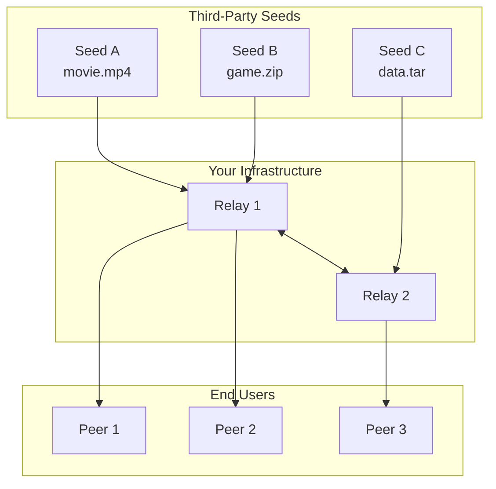

# Magnetk P2P Network - Architecture

## System Overview

**Magnetk** is a hybrid P2P file transfer network with three node types:
- **Relay Nodes** (your infrastructure) - Network backbone
- **Seed Nodes** (third-party VPS) - File hosts using Magnetk SDK
- **Peer Clients** (end users) - Download files via magnet links

---

## Network Topology



---

## Node Type Comparison

| Aspect | Relay | Seed | Peer |
|--------|-------|------|------|
| **Operator** | You | VPS owners | End users |
| **Purpose** | Route traffic | Host files | Download |
| **SDK** | No (core binary) | Yes (SDK) | Yes (SDK) |
| **Storage** | Buffer only | Full files | Downloads |
| **Revenue** | All traffic | None (uses your relay) | None |

---

## Layer Architecture

```
┌─────────────────────────────────────────────────────────────┐
│                   APPLICATION LAYER                          │
├─────────────────────────────────────────────────────────────┤
│  ┌──────────────┐  ┌──────────────┐  ┌──────────────┐      │
│  │  Magnetk SDK │  │ Magnet Link  │  │    Chunk     │      │
│  │   (Go/Py/JS) │  │   Parser     │  │   Manager    │      │
│  └──────────────┘  └──────────────┘  └──────────────┘      │
├─────────────────────────────────────────────────────────────┤
│                   PROTOCOL LAYER (Go)                        │
├─────────────────────────────────────────────────────────────┤
│  ┌──────────────┐  ┌──────────────┐  ┌──────────────┐      │
│  │   libp2p     │  │  Discovery   │  │   Registry   │      │
│  │    Host      │  │   (DHT)      │  │  (on Relay)  │      │
│  └──────────────┘  └──────────────┘  └──────────────┘      │
├─────────────────────────────────────────────────────────────┤
│                   TRANSPORT LAYER (C++)                      │
├─────────────────────────────────────────────────────────────┤
│  ┌──────────────────────────────────────────────────┐      │
│  │              MsQuic (TLS 1.3 + QUIC)             │      │
│  └──────────────────────────────────────────────────┘      │
└─────────────────────────────────────────────────────────────┘
```

---

## Magnet Link Structure

```
magnet:?xt=urn:sha256:<HASH>&dn=<NAME>&xs=<SEED_ID>&relay=<RELAY>

┌────────────────────────────────────────────────────────────┐
│  magnet:?xt=urn:sha256:a1b2c3d4...                        │
│          &dn=awesome-file.zip                              │
│          &xs=Qm1234567890abcdef...                        │
│          &relay=relay.magnet.io:4001                       │
└────────────────────────────────────────────────────────────┘
        │           │           │              │
        ▼           ▼           ▼              ▼
   File Hash   Filename    Seed Peer     Required Relay
```

---

## Data Flow: Complete Download

```
                [SEED VPS]                    [YOUR RELAY]                    [PEER]
                    │                              │                             │
  1. PUBLISH ───────┼─────────────────────────────►│                             │
     {hash, name}   │                              │                             │
                    │◄─────────────────────────────┤                             │
                    │   MAGNET_LINK               │                             │
                    │                              │                             │
                    │                              │◄────────────────────────────┤
                    │                              │   2. RESOLVE {magnet_link}  │
                    │                              │                             │
                    │                              │────────────────────────────►│
                    │                              │   SEED_INFO {addr}          │
                    │                              │                             │
                    │◄─────────────────────────────┼─────────────────────────────┤
                    │   3. CONNECT via relay       │                             │
                    │                              │                             │
                    │─────────────────────────────►│─────────────────────────────►│
                    │   4. MANIFEST                │                             │
                    │                              │                             │
                    │─────────────────────────────►│─────────────────────────────►│
                    │   5. CHUNKS                  │   (routed through relay)    │
                    │                              │                             │
```

---

## Relay Registry Schema

```json
{
  "files": {
    "sha256:abc123...": {
      "name": "movie.mp4",
      "size": 4294967296,
      "chunk_count": 4096,
      "seeds": [
        {
          "peer_id": "Qm...",
          "address": "/ip4/1.2.3.4/udp/4001/quic",
          "last_seen": "2024-01-15T10:00:00Z",
          "bandwidth": "100mbps"
        }
      ],
      "downloads": 12450,
      "created": "2024-01-10T08:00:00Z"
    }
  }
}
```

---

## SDK Components

| SDK | Language | Use Case |
|-----|----------|----------|
| `magnetk-sdk-go` | Go | High-performance seeds, CLI tools |
| `magnetk-sdk-py` | Python | Scripts, automation, backend |
| `magnetk-sdk-js` | JavaScript | Browser downloads, Node.js servers |

---

## Security Model

| Layer | Mechanism |
|-------|-----------|
| **Transport** | QUIC + TLS 1.3 (E2E encrypted) |
| **Identity** | libp2p peer keys (ed25519) |
| **Integrity** | SHA-256 per chunk + file |
| **Routing** | All traffic via trusted relays |
| **Access** | Optional API keys for seeds |
